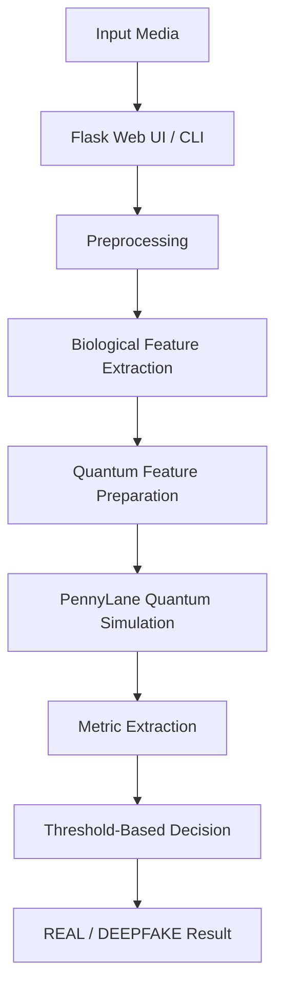

# Deepfake Detection System

## Overview
The Deepfake Detection System is a research-oriented forensic platform designed to identify synthesized or manipulated media. Instead of relying solely on traditional spatial deep-learning models, this canonical implementation (`00_Unified_Deepfake_System`) employs physiological signal extraction combined with mathematical anomaly detection and classical machine learning. 

A novel aspect of this system is its **Quantum Biological Pipeline**, which translates extracted human biological signals into simulated quantum states. By measuring quantum observables such as coherence and entanglement entropy on classical hardware, the system evaluates deviations from calibrated physical baselines to flag non-biological (deepfake) artifacts.

---

## Key Features

### Video Detection
- **Physiological Extraction:** Captures cardiovascular pulse (rPPG), inertial optical flow, and neuromuscular micro-expression strain using MediaPipe FaceMesh.
- **Quantum State Simulation:** Maps biological features into a PennyLane-based quantum simulator to evaluate temporal phase coherence and entropy.
- **Threshold-Based Inference:** Decisions are driven by strict physiological boundaries defined in `calibrated_thresholds.json`, not a neural network black-box.

### Audio Detection
- **MFCC Feature Extraction:** Utilizes `librosa` to extract MFCCs and delta features from audio streams.
- **Classical ML Classification:** Employs a pre-trained Scikit-Learn `joblib` classifier and standard scaler for high-speed voice synthesis detection.

### Image Detection
- **Error Level Analysis (ELA):** Mathematical and heuristic detection of compression artifacts and localized pixel variance via OpenCV. Generates a deterministic anomaly score without relying on trained image models.

### Web & Integration
- **Web UI:** Flask and Flask-SocketIO backend providing real-time upload and analysis progress.
- **Browser Extension:** A Chrome extension capable of capturing frames from browser media and forwarding them to the local canonical backend (`localhost:8080`).

---

## System Architecture



---

## Quantum Simulation Claims
**Important Technical Note:** This project utilizes `pennylane` (`qml.device("default.mixed")`) to perform genuine quantum-state simulation **on classical CPU hardware**. 

This system does *not* execute on physical quantum hardware (such as IBM Quantum execution runtimes), nor does it currently claim "quantum advantage". The quantum mechanics paradigm is used heuristically here as a mathematical framework to represent and measure the entanglement and purity of complex biological signals.

---

## Models and Calibration
The canonical system relies on the following configurations and classical models:
- `00_Unified_Deepfake_System/model/audio_classifier.pkl`: A trained classical machine-learning classifier exclusively for audio detection.
- `00_Unified_Deepfake_System/model/scaler.pkl`: The standard scaler paired with the audio classifier.
- `00_Unified_Deepfake_System/model/calibrated_thresholds.json`: The rule-based physiological boundary file driving the video deepfake decisions.

*(Note: There is no `.pt`, `.pth`, or `.onnx` deep-learning neural network utilized for video frame classification).*

---

## Project Structure
- `00_Unified_Deepfake_System/`: **The Canonical Implementation.** Contains the fully unified Flask application, audio/image/video pipelines, and the Chrome extension integration.
- `02_Video_Deepfake_1/`: **Legacy Implementation.** An older, video-only prototype retained for archival and research tracking. It should not be used as the primary runtime.
- `03_Documentation/`: Background industry research and documentation.

---

## Installation

1. **Clone the repository:**
   ```bash
   git clone https://github.com/mananbd07/Deepfake-System.git
   cd Deepfake-System
   ```

2. **Create a Python 3.11 Virtual Environment:**
   ```bash
   python -m venv venv
   # On Windows:
   venv\Scripts\activate
   # On macOS/Linux:
   source venv/bin/activate
   ```

3. **Install Dependencies:**
   ```bash
   pip install -r requirements.txt
   ```
   *(Ensure `mediapipe==0.10.9` is successfully installed as it is strictly required by the FaceMesh pipeline).*

---

## Running the Application

To start the canonical Flask web server (running on port `8080`):
```bash
cd 00_Unified_Deepfake_System
python qbioforge_web/app.py
```
Navigate to `http://localhost:8080` in your browser.

## CLI Usage

You can run individual videos through the forensic pipeline directly from the terminal:
```bash
cd 00_Unified_Deepfake_System
python -m experiments.run_single_video --video <path_to_mp4>
```

---

## Chrome Extension
The repository includes a Manifest V3 Chrome extension designed to communicate with the canonical backend.
1. Start the Flask server so it is listening on `http://localhost:8080`.
2. Load the `00_Unified_Deepfake_System/qbioforge_extension/` directory as an "Unpacked Extension" in Chrome.
3. The extension captures browser video frames and forwards them to the backend API (`/api/frame_scan`) for real-time inference.

---

## Dataset / Test Media
**Note:** Large datasets and test videos (over 700+ `.mp4` files) are intentionally excluded from version control via `.gitignore`. Users must provide their own compatible test media to evaluate the system. Please do not commit massive datasets to this repository.

---

## Limitations
- **Threshold Dependency:** The video detector's accuracy is heavily dependent on the rigid biological thresholds defined in `calibrated_thresholds.json`, which may fail on extreme lighting, heavy makeup, or non-standard framerates.
- **Hardware Profile:** The quantum component is simulated on classical hardware, limiting real-time throughput scalability.
- **Audio Length:** The audio classification model requires clean audio clips of sufficient duration; very short clips will be automatically rejected.
- **Backend Coupling:** The Chrome extension requires the local Flask backend to be actively running on port 8080.
- **Lack of Broad Benchmarking:** The repository currently acts as a functional prototype; its generalization accuracy across diverse, wild datasets requires further empirical benchmarking.

---

## Research Status
**Status: Implemented & Experimental**
While the biological extraction pipeline, Flask UI, classical ML audio detection, and ELA image pipeline are fully implemented and functional, the **Quantum Biological Representation** and **biological threshold methodology** remain highly experimental research concepts. They demonstrate a novel forensic approach rather than a scientifically conclusive, production-ready enterprise solution.

---

## Author
**Manan Bidawatka**  
GitHub: [https://github.com/mananbd07](https://github.com/mananbd07)  
Repository: [https://github.com/mananbd07/Deepfake-System](https://github.com/mananbd07/Deepfake-System)
